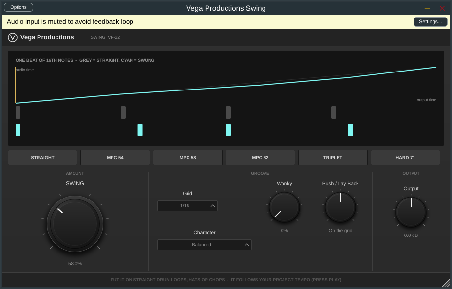

# Vega Productions Swing (VP-22)

Swing for **audio**: turns straight drum loops, hats, chops and bounced stems into swung, triplet or wonky grooves in real time — locked to your project tempo, with no pitch change.



## Download
- **Windows (FL Studio):** https://github.com/DJVega70/vega-swing/releases/latest/download/VegaProductions-Swing-Windows-VST3.zip
- **macOS:** https://github.com/DJVega70/vega-swing/releases/latest/download/VegaProductions-Swing-macOS-VST3-AU.zip

## How it works
Every off-beat 8th / 16th / 32nd is moved later in time. The hits themselves are never stretched — the audio is only stretched and squeezed in the quiet tail *between* hits, so transients stay sharp and land sample-accurately on the new grid.

## Controls
- **Swing** 50% (straight) → 75%, with presets: Straight, MPC 54 / 58 / 62, **Triplet** (66.7%), Hard 71.
- **Grid:** 1/8, 1/16, 1/32.
- **Wonky:** a different swing on every beat for a loose, drunk, J Dilla-style feel.
- **Push / Lay Back:** shifts the whole part ±25 ms ahead of or behind the beat.
- **Character:** Tight (drums), Balanced, Smooth (pads, vocals).
- Latency is reported to the host, so it stays in time with the rest of the project. Press play — the groove follows the song position.

## Building
```
cmake -B build -DVEGA_TESTS=ON
cmake --build build --config Release --target VegaSwing_VST3 VegaSwingTest
```
